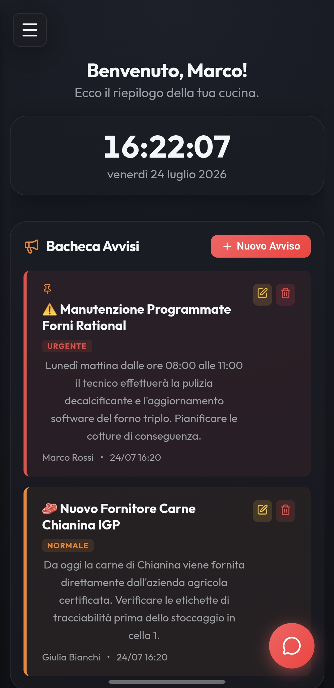
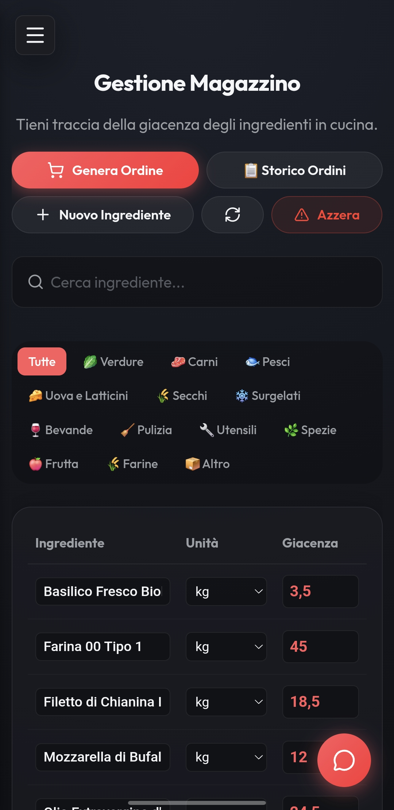
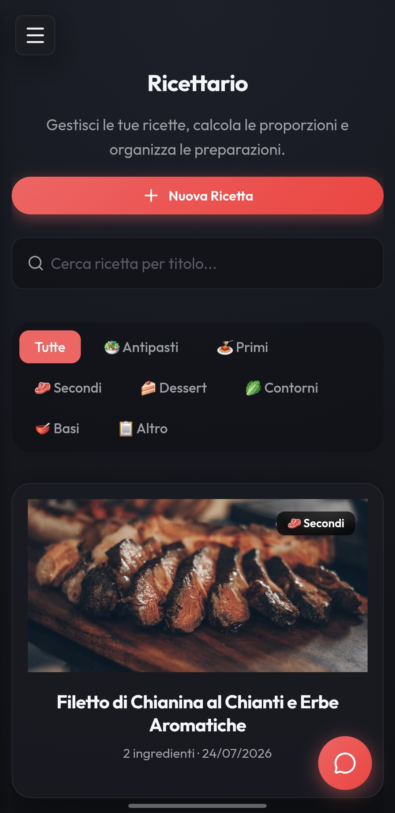
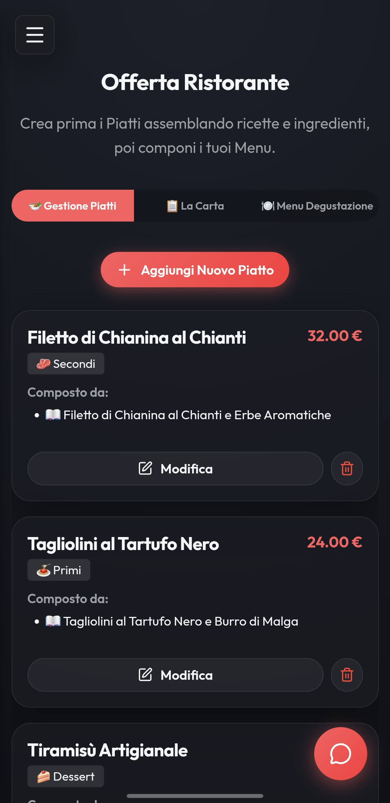
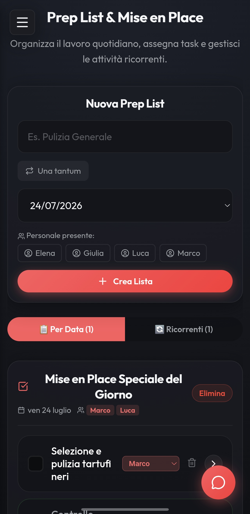
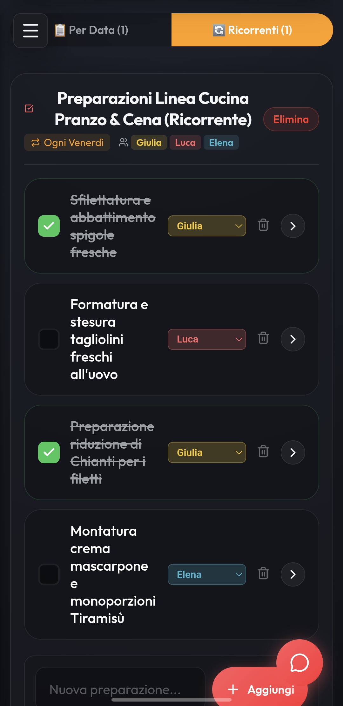
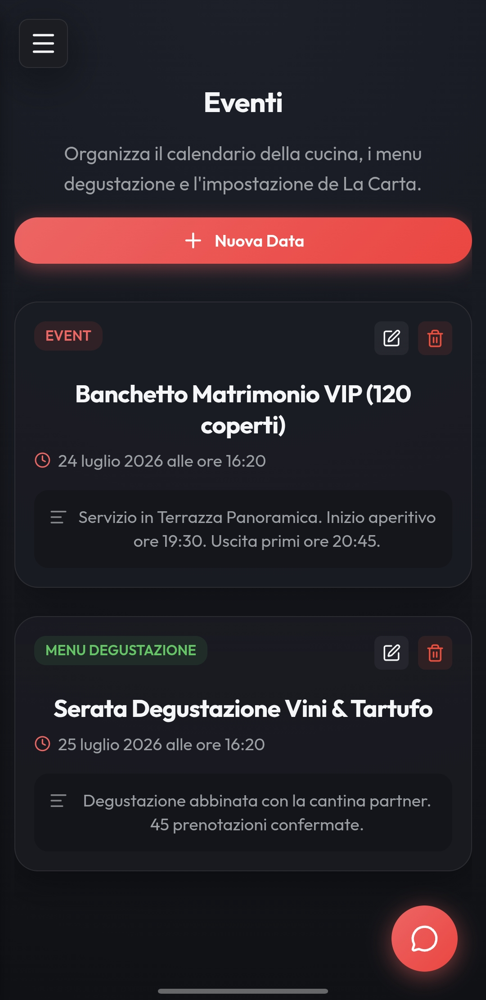

<h1 align="center">Kitchen App</h1>
<p align="center">
  <b>Modern Kitchen & Restaurant Management Platform</b><br/>
  Gestisci la tua cucina, magazzino, ricettario e prep-list con un'interfaccia moderna e reattiva installabile come PWA.<br/>
  <i>Manage your kitchen, inventory, recipe book, and prep-lists with a modern reactive UI installable as a PWA.</i>
</p>

<p align="center">
  
  
  
  
  
  
  
</p>

<p align="center">🇮🇹 <b>Italiano</b> · <a href="#-english">🇬🇧 English</a></p>

---

## 📸 Panoramica UI / UI Overview

> Interfaccia moderna in modalità scura, ottimizzata per smartphone, tablet e desktop.

<p align="center"><b>Home & Dashboard Overview</b></p>
<p align="center"></p>

<p align="center"><b>Gestione Magazzino (Inventario)</b></p>
<p align="center"></p>

<p align="center"><b>Ricettario & Schede Tecniche</b></p>
<p align="center"></p>

<p align="center"><b>Menu Degustazione & Carte</b></p>
<p align="center"></p>

<p align="center"><b>Prep List & Organizzazione Lavoro</b></p>
<p align="center"></p>

<p align="center"><b>Mise en Place</b></p>
<p align="center"></p>

<p align="center"><b>Calendario Eventi & Prenotazioni</b></p>
<p align="center"></p>

<p align="center"><b>Chat Interna & Comunicazione della Brigata</b></p>
<p align="center"></p>

---

# 🇮🇹 Italiano

## ✨ Descrizione Progetto

**Kitchen App** è una Web Application completa ed elegante sviluppata specificamente per ottimizzare e digitalizzare i flussi di lavoro all'interno delle cucine professionali e dei ristoranti. 

Offre una dashboard centrale per monitorare in tempo reale lo stato delle scorte, gestire la lista della spesa, organizzare le preparazioni (Prep List / Mise en Place), consultare le ricette con dosi e procedimenti e coordinare gli eventi e il personale.

## 🚀 Caratteristiche Principali

### 📦 Gestione Magazzino e Inventario
- Visualizzazione immediata della giacenza degli ingredienti, sottoscorta e unità di misura.
- Layout reattivo ad altissima leggibilità anche su schermi mobili da cucina.
- Aggiornamento immediato delle quantità e tracciamento dei fornitori.

### 📖 Ricettario Digitale & Carte Menu
- Schede dettagliate per ogni ricetta con ingredienti, quantità e passaggi.
- Supporto per immagini ad alta risoluzione dei piatti.
- Gestione dei Menu (incluso il **Menu Degustazione** e menu del giorno).

### 📝 Prep-List & Mise en Place
- Liste di preparazione suddivise per data o ricorrenti per linea di servizio.
- Form rapido per aggiungere task senza interrompere il flusso di lavoro.
- Avanzamento visivo e spunta delle preparazioni completate.

### 📅 Eventi & Calendario
- Organizzazione di banchetti, serate speciali e prenotazioni.
- Integrazione rapida con le preparazioni necessarie per singolo evento.

### 💬 Chat Interna di Brigata
- Canale di comunicazione integrato per lo staff della cucina e della sala per lo scambio rapido di note ed emergenze.

### 📱 Progressive Web App (PWA)
- Installabile direttamente come applicazione su dispositivi Android, iOS, iPad e Desktop.
- Avvio immediato a schermo intero senza barre del browser.

---

## 🧱 Architettura Tecnologica

- **Frontend**: [Next.js 15](https://nextjs.org/) (App Router), React 19, TypeScript, Vanilla CSS con variabili CSS personalizzate per massima flessibilità e fluidità.
- **Backend & Database**: API Routes native Next.js, [Prisma ORM](https://www.prisma.io/) interfacciato con **PostgreSQL**.
- **Containerizzazione**: Configurazione standard **Docker** e `docker-compose.yml` per un deployment semplice ed isolato.
- **Autenticazione**: Gestione sessioni sicura con supporto per visibilità password e preferenze salvate.

---

## 🛠️ Requisiti & Setup Docker

### Prerequisiti
- Docker Engine 20.10+ e Docker Compose installed.

### Avvio Rapido

1. Clonare il repository:
   ```bash
   git clone https://github.com/giosci1994/kitchen-app.git
   cd kitchen-app
   ```

2. Configurare le variabili d'ambiente creando un file `.env`:
   ```env
   DATABASE_URL="postgresql://kitchen:kitchen_pass@db:5432/kitchendb?schema=public"
   NEXTAUTH_SECRET="tuo_secret_chiave"
   NEXTAUTH_URL="https://kitchen.casadm.uk"
   ```

3. Avviare il container con Docker Compose:
   ```bash
   docker compose up -d --build
   ```

4. Eseguire le migrazioni del database e il seeding dei dati dimostrativi (opzionale):
   ```bash
   docker compose exec app npx prisma migrate deploy
   docker compose exec app node scripts/seed-demo.js
   ```

La piattaforma sarà raggiungibile su `http://localhost:3000` o sul dominio configurato nel reverse proxy.

---

# 🇬🇧 English

## ✨ Project Overview

**Kitchen App** is a complete, modern web application engineered to streamline workflows, inventory tracking, recipe documentation, and daily prep tasks for professional kitchens and restaurants.

## 🚀 Key Features

- **Inventory & Stock Management**: Real-time ingredient tracking with low-stock warnings and mobile-optimized tables.
- **Digital Recipe Book & Menus**: Comprehensive recipe cards with step-by-step instructions, media attachments, and Degustation menu management.
- **Prep List & Mise en Place**: Daily or date-specific prep schedules to keep the kitchen brigade in sync.
- **Event Scheduling**: Calendar overview for catering, special dinners, and banquet preparation.
- **Internal Staff Chat**: Built-in messaging tool for fast communication between kitchen and front-of-house staff.
- **Installable PWA**: Native app experience on iOS, Android, and Desktop via Progressive Web App standards.

---

## ⚙️ GitHub Repository Configuration

Per configurare al meglio il repository su GitHub come nell'esempio reference:

### 📝 Description
`Modern Kitchen & Restaurant Management Platform (PWA, Inventory, Recipes, Prep-Lists & Docker ready)`

### 🏷️ Topics
`kitchen-management` · `restaurant` · `inventory` · `pwa` · `nextjs` · `prisma` · `postgresql` · `docker` · `recipes` · `prep-list`

### 🖼️ Social Preview
Nei settings di GitHub (*Settings > General > Social preview*), carica il file `docs/Home.jpg` come immagine di copertina repository.

---

<p align="center">
  Crafted with ❤️ by <a href="https://github.com/giosci1994">giosci1994</a>
</p>
